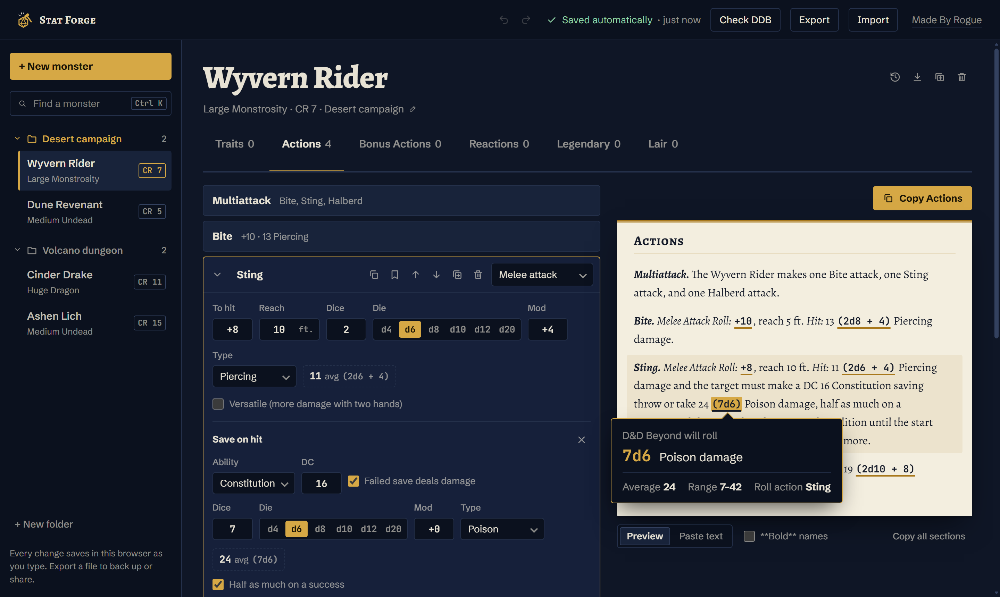
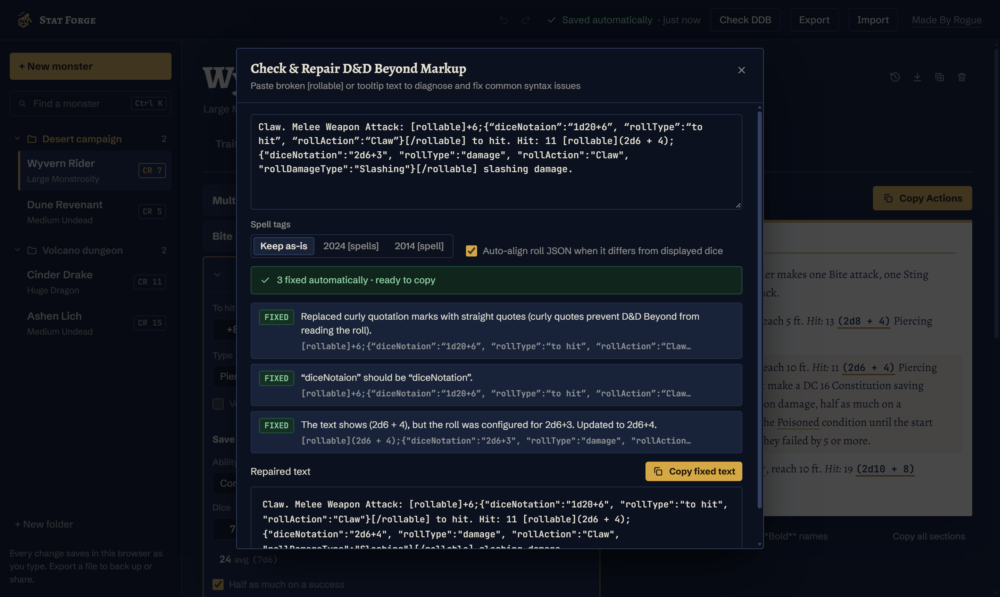
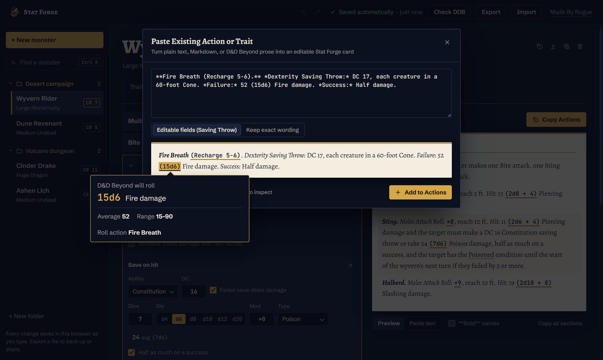
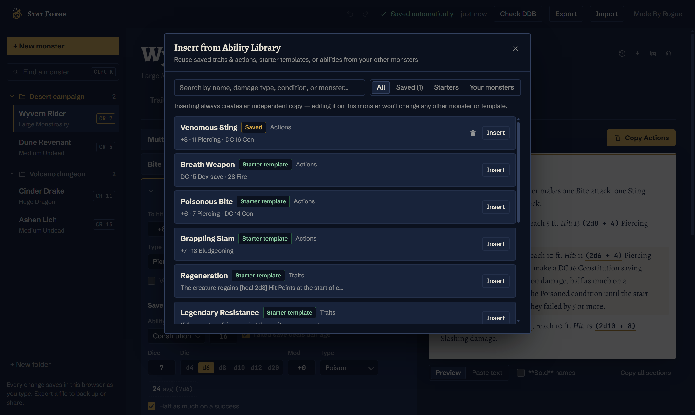

<div align="center">

<a href="https://statforge.roguesector.dev/">
  
</a>

# Stat Forge

Build D&D monster actions with clickable D&D Beyond and AboveVTT dice (`[rollable]...[/rollable]`) without writing the markup by hand.

Enter the numbers you already know, check the live preview, and paste each section into D&D Beyond. Everything runs in your browser with no account and no server.

<p>
  <a href="https://statforge.roguesector.dev/">
    
  </a>
</p>

<p>
  <a href="https://github.com/Rogue-Sector/statforge/actions/workflows/test.yml">
    
  </a>
  <a href="LICENSE">
    
  </a>
  
  
</p>

</div>

<p align="center">
  <a href="https://statforge.roguesector.dev/">
    
  </a>
</p>

## What it does

- One tab per D&D Beyond box: Traits, Actions, Bonus Actions, Reactions, Legendary Actions, and Lair Actions. Each tab tracks whether you have copied it and flags when an edit changes the pasted text.
- Switch any monster between 2024 wording (`Melee Attack Roll:`, `Failure:`, `[spells]`) and 2014 wording (`Melee Weapon Attack:` or `Melee Spell Attack:`, `taking ... on a failed save`, `[spell]`).
- Supports Multiattack, versatile two-handed damage, extra damage, healing and life drain, on-hit saving throws, conditions, Miss and Hit-or-Miss lines, clickable `(Recharge 5-6)`, and Spellcasting with clickable spell attack bonuses.
- Hover or Tab to any underlined value in the preview to see the exact dice, roll type, damage type, average, range, and roll action name that D&D Beyond will roll.
- Your monsters save automatically in `localStorage`, with `Ctrl+Z` / `Ctrl+Y` undo, undoable deletes, local recovery checkpoints (before your first edit of a session, when you copy, and before imports), and JSON Export/Import.

## Fixing broken D&D Beyond markup

Open Check DDB in the top bar and paste raw text straight from a D&D Beyond homebrew box. It catches and repairs curly quotes, missing quotes or closing tags, typos like `diceNotaion`, display-vs-dice mismatches, and missing `rollDamageType`, then gives you clean text to copy back.



## Pasting existing actions

Use Paste action to drop in plain text, Markdown, or existing D&D Beyond prose. Standard attacks, saving throws, and Spellcasting blocks become editable fields with a live preview. If an ability has unusual wording, switch to Keep exact wording to preserve the text while still turning its dice and conditions into clickable rolls.



## Reusing abilities across monsters

Click the bookmark icon on any open card to save it to your library. From library lets you search your saved abilities, pull actions from your other monsters, or start from built-in patterns (Breath Weapon, Poisonous Bite, Grappling Slam, Regeneration, Legendary Resistance, Teleport, and Innate Spellcasting). Inserting always makes an independent copy.



## Inline dice and tooltips

Descriptions, reaction Triggers and Responses, riders, Miss text, custom Success text, Multiattack extra text, and custom Lair intros accept inline rolls and D&D Beyond tooltip tags:

| Type this | Produces |
| :--- | :--- |
| `{1d4}` | Clickable plain roll (`1d4`) |
| `{dmg 3d6 Fire}` | `10 (3d6)` clickable Fire damage roll (damage type is optional) |
| `{heal 2d8+4}` | `13 (2d8 + 4)` clickable healing roll |
| `{+5}` | Clickable `+5` to-hit roll (`1d20+5`) |
| `{condition Prone}` | `[condition]Prone[/condition]` (checked against the 5e list) |
| `{skill Perception}` | `[skill]Perception[/skill]` (checked against the 5e list) |
| `{spell Fireball}` | `[spells]Fireball[/spells]` in 2024 wording or `[spell]Fireball[/spell]` in 2014 wording (use `{spells ...}` or `{spell14 ...}` to force one) |
| `{action Hide}` / `{sense Darkvision}` | `[action]Hide[/action]` / `[sense]Darkvision[/sense]` |
| `\{` | Literal `{` |

## Keyboard shortcuts

| Shortcut | Action |
| :--- | :--- |
| `Ctrl+K` / `Cmd+K` | Find a monster by name, folder, or type |
| `Ctrl+N` / `Cmd+N` | New monster |
| `Ctrl+Shift+C` / `Cmd+Shift+C` | Copy all sections |
| `Ctrl+Z` / `Ctrl+Y` | Undo or redo changes |

<details>
<summary>More usage notes (monster details, Spellcasting, Lair Actions, copying and backup)</summary>

- Click the line under a monster's name to set its size, type, CR, folder, how the text refers to it (such as `"The dragon"`), and its 2024 or 2014 wording. Size, type, CR, and folder only organize your sidebar and never appear in copied text.
- In Spellcasting, separate spells with commas per frequency line (`At Will`, `1/Day Each`, and so on). Anything in parentheses like `(level 4 version)` stays outside the tooltip tag. Wrap a custom homebrew spell in `"quotes"` to leave it as plain text, or change Spell tooltips on the card.
- Lair actions take Text or Saving Throw entries. Leave the name blank for bare paragraphs like the Monster Manual, and edit the Lair Actions intro card to change the initiative count, repeat rule, or custom opening paragraph.
- Pasting into D&D Beyond's rich-text boxes makes action names bold-italic automatically. Turn on `**Bold** names` if you want Markdown bold in the plain-text view, or click any block in the preview to copy just that action.
- Everything stays in your browser's `localStorage`. Use Export (or the download icon next to a monster's name) to save a `.json` backup or share monsters and saved abilities, and Import to load them.

</details>

## Developing

Stat Forge is a static site in `src/` written in plain JavaScript with no build step.

```bash
npx serve src    # preview locally in your browser
npm test         # run the unit tests (requires Node)
```

- `src/format.js`: statblock token and D&D Beyond markup generation.
- `src/library.js`: copied-section hashing, folder grouping, search ranking, milestone checkpoints, and starter templates.
- `src/ddb.js`: D&D Beyond markup checker/repairer and pasted-action parser.
- `src/index.html`, `src/styles.css`, `src/app.js`: UI and self-hosted SIL OFL fonts (`src/fonts/`).
- `PRODUCT.md`: product brief.

## License

MIT (see [LICENSE](LICENSE)). Not affiliated with Wizards of the Coast or D&D Beyond.
